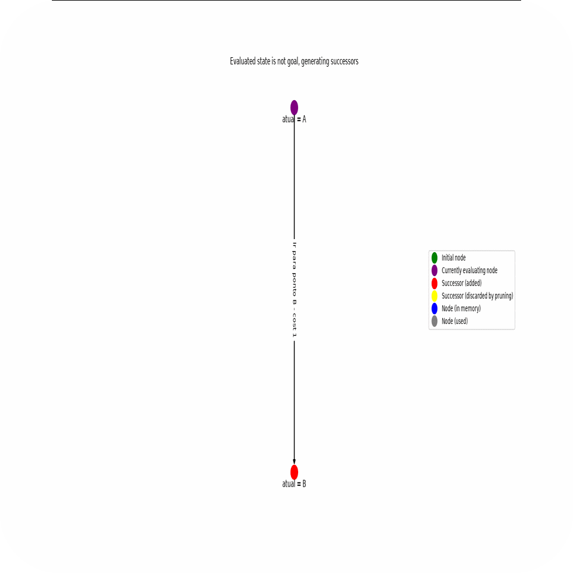

# 

---

## What I've Built & Contributed To

---

### Haskllite <small>[:link:](https://github.com/marcelopenas/haskllite)</small> 

A interpreter & compiler for a programming language inspired by Rust's syntax, implemented in Haskell. It serves as a subset designed to demonstrate core compiler concepts including lexical analysis, parsing, and AST interpretation. It supports functions, bindings, typing, ternaries, I/O and more.

---

### AI Gym <small>[:link:](https://github.com/Insper/ai_gym)</small> 

An educational toolkit for building and testing artificial intelligence agents. I contributed with a graph state visualization tool, which renders abstract state spaces into observable networks. This allows debugging search algorithms, tracking how agents explore, evaluate heuristics, and optimize their decision trees.

---

### BatchFetch <small>[:link:](https://github.com/marcelopenas/batchfetch)</small> 

BatchFetch is a lightweight C11 command-line downloader that efficiently fetches multiple URLs in controlled parallel batches, with URL deduplication, automatic filenames, configurable concurrency, and graceful interruption handling.

---

  <i>Feel free to reach out to me via <a href="mailto:marcelopenas@outlook.com">email</a> or connect with me on <a href="https://linkedin.com/in/marcelopeñas">LinkedIn</a>!</i>

